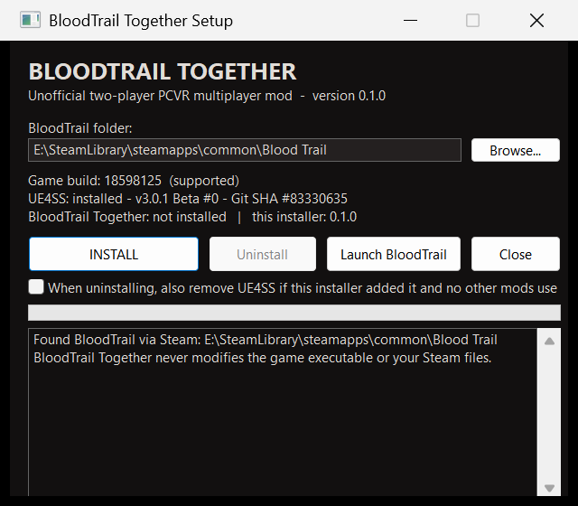

# BloodTrail Together

Unofficial two-player PCVR multiplayer mod for **BloodTrail** (Steam). Two players on their own
normal Steam installs meet in the same map, see each other's head and hands, and hear each other's
gunfire and hand sounds. One player creates a session and reads out a short **join code**; the other
types it in. No VPN, no Hamachi/Radmin, no port forwarding, no changes to the game executable.

> **Status: v0.1.0 — early alpha, not yet verified in-game.** The networking, Unity Relay client,
> installer and the game-side bridge are built and covered by automated tests (see below). The parts
> that run inside the game (`Scripts/main.lua`) have not yet been tested in a headset. Expect bugs.

 

## Install (players)

1. Download **`BloodTrailTogether-Setup-vX.Y.Z.exe`** from [Releases](../../releases).
2. Run it. It finds BloodTrail in your Steam libraries (or click **Browse…**).
3. Click **Install**.
4. Start BloodTrail through Steam as usual.
5. Press **F9** in game for the multiplayer window → **Create Session** (host) or type the code → **Join Session**.

Details: [INSTALLATION.md](INSTALLATION.md) · Problems: [TROUBLESHOOTING.md](TROUBLESHOOTING.md)

## What works in v0.1.0

| Feature | State |
|---|---|
| Unity Relay sessions with join codes (no port forwarding / VPN) | implemented; protocol checked against Unity's reference client; tested against a local mock relay. Live Unity test pending the project id |
| Remote avatar: head + both controllers, interpolated, name tag with ping | implemented; in-game test pending |
| Both game modes (Sandbox and Arcade: Raid / Arenas) | client follows the host's map (both modes load maps the same way); in-game test pending |
| Shared positional audio (gunshots, hand sounds near a player) | implemented via UE4SS hooks; in-game test pending |
| Disconnect / interruption detection, rejoin with the same code | implemented and tested |
| Test without a second person (simulated player) | implemented and tested |
| Shared NPCs / doors / raid state | **not yet** — see roadmap |

## Roadmap
- In-game verification of avatar, map following and audio (v0.1.x)
- Proper hand/head meshes instead of primitive shapes
- Host-authoritative world state: doors, pickups, raid/wave counters
- Shared NPCs (host simulates, client shows puppets) — the hardest part, not guaranteed

## How it works (short)
`btt_core.dll` (C++, no Unreal headers) does networking, Unity Relay and the desktop multiplayer window.
A UE4SS Lua script reads the VR pose every frame and draws the other player. They talk over a local
named pipe (~50 µs per frame). Full design: [docs/ARCHITECTURE.md](docs/ARCHITECTURE.md).

## Developers
Visual Studio 2022 (C++), Python 3. `build.cmd` builds everything; `btt_tests.exe` runs the test suite;
`btt_simpeer.exe` is a headless second player; `python -I tools/make_release.py` builds a release.
See [docs/DEVELOPMENT.md](docs/DEVELOPMENT.md).

## Legal
MIT licensed ([LICENSE](LICENSE)). Unofficial fan project, not affiliated with Electrovore, LLC.
You need your own legitimate copy of BloodTrail on Steam. Third-party notices: [THIRD_PARTY_NOTICES.md](THIRD_PARTY_NOTICES.md).
