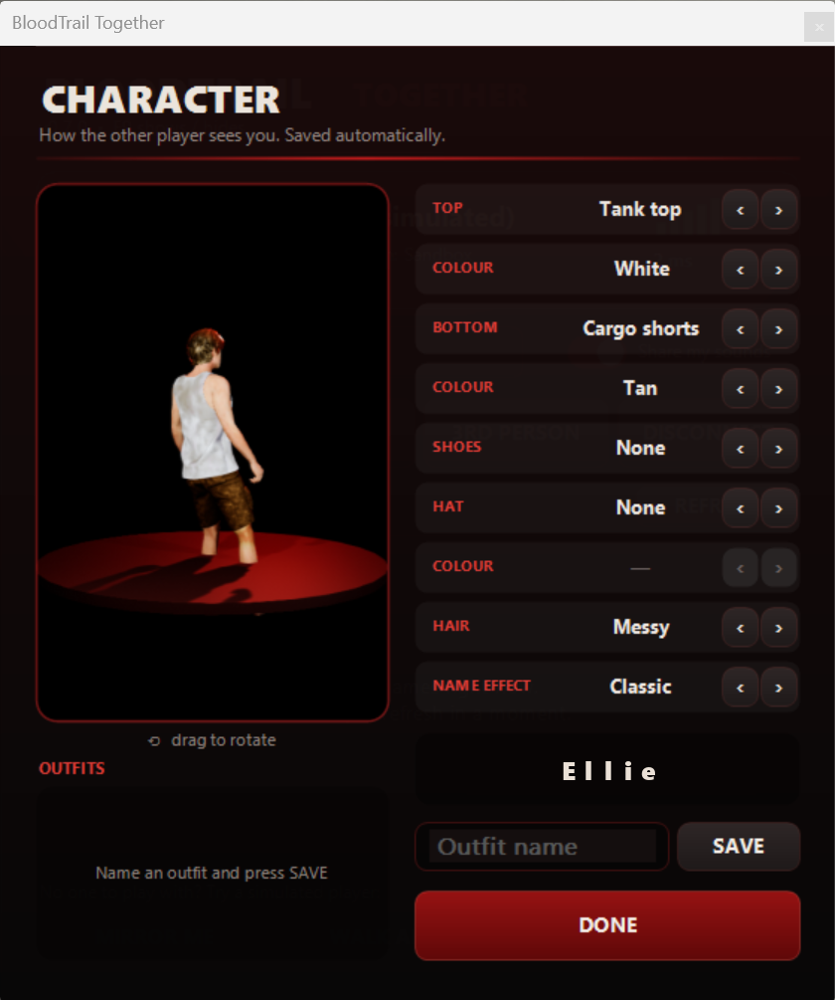
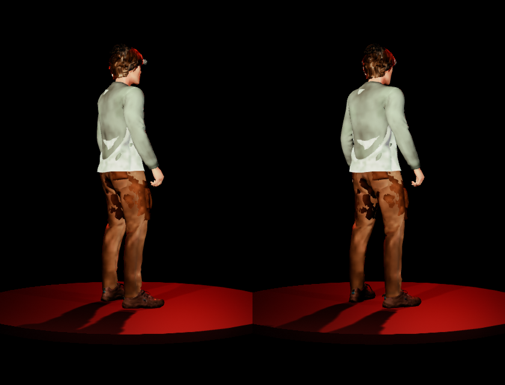
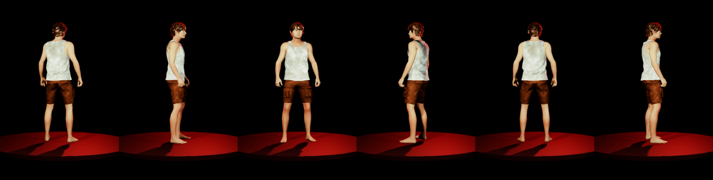

  

  
  
  

  
  
  
  
  
  

---

**BloodTrail Together** is an unofficial, free mod that lets **two players play BloodTrail together in VR**, in co-op against the NPCs or fighting each other. Host with one click, and your friend joins from the server list. No VPN, no port forwarding, and the game's own files are left untouched.

> $\color{#ff5a4a}{\textsf{Early access.}}$ Everything below is built and tested in the game with a simulated second player. A full two-player VR session is the next big test, so please report anything that feels off.

## $\color{#e0504a}{\textsf{Features}}$

| | |
|---|---|
| 🧍 **Full-body players** | Your friend is a full human body: head follows their headset, arms follow their controllers, legs walk, strafe and turn, fingers wrap round what they hold. |
| 🔫 **Real combat** | Shoot each other with location damage (headshots kill), the game's own gore and ragdolls, muzzle flashes, bullet holes, 3D gunshots, death and respawn. |
| 🧟 **Shared NPCs** | The same NPCs in both games: synced movement, wounds, bodies, and voices with subtitles. They hear and attack **both** players. |
| 🧠 **Smarter NPCs** | NPCs take ammo from dead bodies, run for it or surrender when losing, and investigate both players' noise. Works in single-player too. |
| ✋ **Grab and throw** | Dragging and throwing bodies and map objects is synced between both games. |
| 🔦 **Head lamp and night vision** | Your head lamp lights the world for your friend too. |
| 🎨 **Character customisation** | A live 3D preview rendered by the game. Choose tops, bottoms, shoes, hats, hair, a hidden headlamp and outfits, all in the game's own colours. Save and name outfits. |
| 🌈 **Name effects** | Rainbow, Sunset, Fire, Ice, Gold, Toxic, Pulse, Glitch and Wave, shown letter by letter above your head. |
| ⌚ **Hologram watch** | Tap your wrist: host, quick join, leave, scoreboard, and settings. |
| 🏆 **Scoreboard and spectating** | Kills, headshots and deaths for both players. Watch your friend while you're dead. |
| 🎥 **Third person** | An over-the-right-shoulder view (experimental). |
| 🌐 **Server list** | No codes: host and the game appears in everyone's list. The nearest relay region is chosen automatically. |

  
  

## $\color{#e0504a}{\textsf{Install}}$

1. Download **`BloodTrailTogether-Setup-vX.Y.Z.exe`** from [Releases](https://github.com/doktordestrukt/BloodTrailTogether/releases/latest).
2. Run it. It finds BloodTrail in your Steam libraries and installs everything, including [UE4SS](https://github.com/UE4SS-RE/RE-UE4SS) if needed.
3. Start BloodTrail through Steam as usual.
4. Press **F9** (or tap your watch). One player clicks **HOST GAME**, the other clicks **JOIN** on that game in the **server list**.

**Both players need the mod.** Versions with the same network format can still play together; otherwise the game tells you to update.
More: [INSTALLATION.md](INSTALLATION.md) · [TROUBLESHOOTING.md](TROUBLESHOOTING.md) · [CHANGELOG.md](CHANGELOG.md)

## $\color{#e0504a}{\textsf{Known limits}}$

- On the **host**, while live AI NPCs are around, the other player's arms use the game's own animation. Arm tracking there crashed the game.
- NPC AI only targets the host natively. Shots and melee at the joining player are simulated from the host's NPCs.
- NPC subtitles describe each line; the game has no transcripts.
- Objects spawned mid-game (dropped magazines, casings) are not synced. Only objects that are part of the map are.

## $\color{#e0504a}{\textsf{How it works}}$

`btt_core.dll` (C++, no Unreal headers) handles networking (Unity Relay and Lobby), the animated F9 window and the installer logic. A UE4SS Lua script reads your VR pose every frame and drives the other player's body, gun, gore and effects through the game's own systems. The two talk over a local named pipe (~50 µs per frame). Full design: [docs/ARCHITECTURE.md](docs/ARCHITECTURE.md).

## $\color{#e0504a}{\textsf{Developers}}$

Visual Studio 2022 (C++) and Python 3. `build.cmd` builds everything, `btt_tests.exe` runs the test suite, `btt_simpeer.exe` is a headless second player, and `python -I tools/make_release.py` builds a release. See [docs/DEVELOPMENT.md](docs/DEVELOPMENT.md).

## $\color{#e0504a}{\textsf{Legal}}$

**Source-available, not open source** ([LICENSE](LICENSE)): you may download BloodTrail Together from this repository and play with it, and read and study the code. You may **not** re-upload it anywhere else, publish modified versions, or sell it. © 2026 doktordestrukt (aka ellie). An unofficial fan project, not affiliated with Electrovore, LLC. You need your own legitimate copy of BloodTrail on Steam. Third-party notices: [THIRD_PARTY_NOTICES.md](THIRD_PARTY_NOTICES.md).
